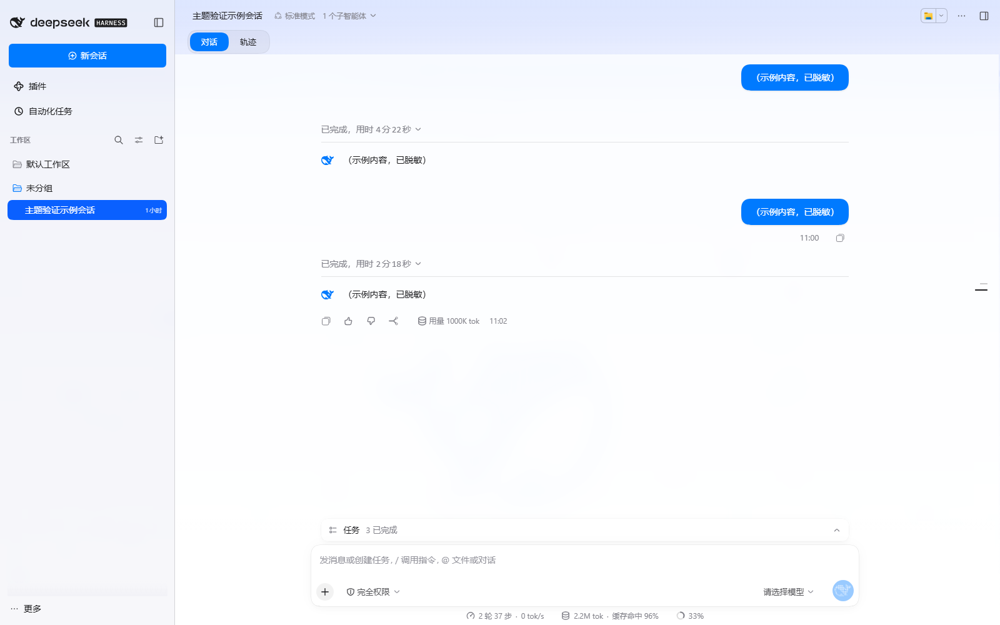
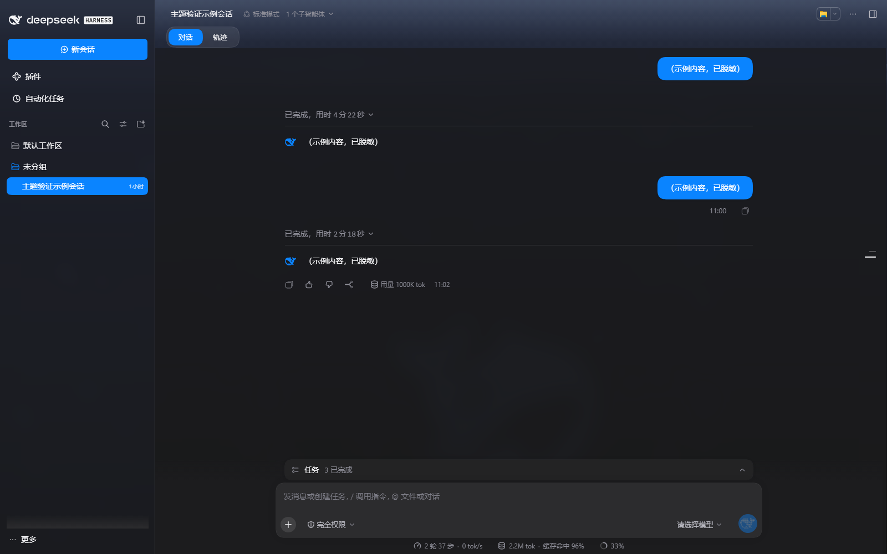
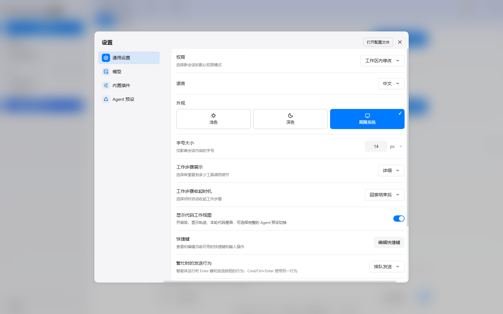
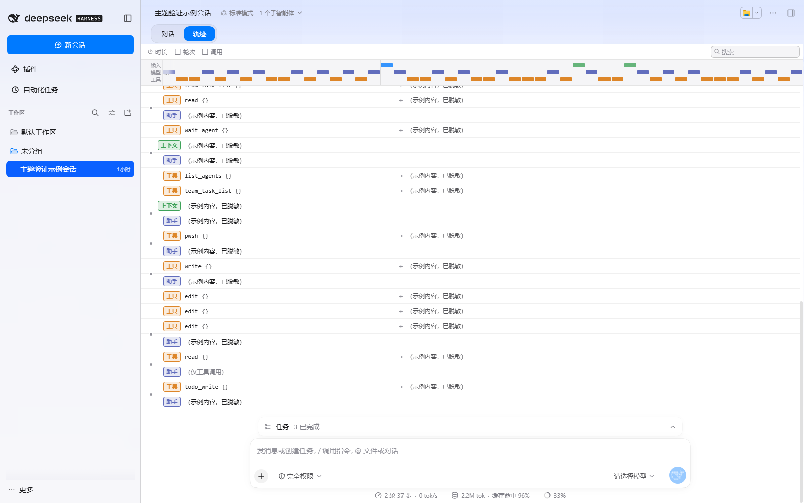
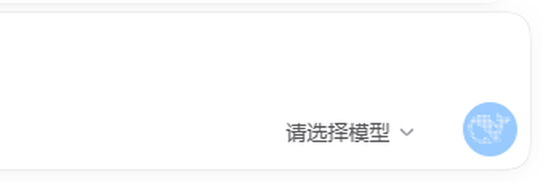
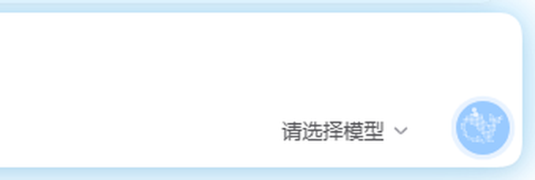

# 🐋 鲸蓝戏水 · DSH Whale Aqua Theme

给 [DeepSeek Harness](https://www.deepseek.com) 用的 **macOS 风格主题 + 水中鲸鱼动态背景 + 点阵鲸鱼发送按钮**，以 DSH 插件形式安装，支持 **Desktop 桌面版**与 Web 版。

> **当前版本 v2.0.0**：已适配 DeepSeek Harness **0.2.x（Desktop 0.2.1-rc.2 实测）**。旧版 v1.x 仅适用于 0.1.x（Harmony 早期版本）。兼容性细节与改造记录见 [COMPATIBILITY.md](COMPATIBILITY.md)。

## 🖼️ 预览

> 主题在真实 DSH 中的效果（截图来自本地 DSH Desktop / Web 运行实例）。

### 浅色模式



### 深色模式



### 设置面板



### 轨迹视图



### 鲸鱼发送按钮

未发送（空闲，静态鲸鱼）：



发送之后（运行中：摆尾游动 + 喷水泡 + 蓝色呼吸光环 + 水母发光）：



### 动态效果


> `demo/preview.html` 是纯静态演示页（使用主题 CSS 与背景脚本，内容为虚构示例），可作为离线预览；它保留的是 0.1.x 时代的界面结构，仅用于看视觉效果。

## ✨ 效果一览

- **水中鲸鱼背景**：极淡水色渐变（底部透明）+ 上升气泡（水面爆开）+ 点阵鲸鱼巡游（S 形行进波、尾部大摆、受惊吐泡）
- **鲸鱼发送按钮**：官方鲸鱼剪影，空闲静态；运行时头顶喷水泡 + 蓝色呼吸光环
- **苹果风皮肤**：macOS 配色（明/暗双主题）、克制圆角、毛玻璃菜单、Finder 式选中、水母发光输入框、磨砂对话区、设置面板统一化、轨迹彩色方框徽章
- **Desktop 适配**：正确处理 Electron 窗口的透明底板、Windows 40px 标题栏拖拽带、窗口按钮取色；水景从标题栏下方开始，不遮挡原生窗口控件
- **低开销**：DPR 1.25、24fps、失焦/隐藏自动暂停、按钮动画按需绘制
- **可随时停用**：不改任何 `dist` 文件，插件停止即移除 `<style>`、canvas、监听与动画循环

## 📋 版本兼容性

| DSH 版本 | 主题版本 | 说明 |
| --- | --- | --- |
| **0.2.x（含 Desktop 桌面版）** | **v2.0.0** | 当前版本，实测 0.2.1-rc.2 |
| 0.1.x（Harmony 早期 Web 版） | v1.0.0 | 旧版，已归档标签 |

0.2.x 相对 0.1.x 重写了整个前端（组件、类名、Desktop 外壳），因此 v2 不是“改几个选择器”，而是重做了皮肤层：

- **插件加载**：`client.js` 的模块注册 id 必须等于包名（`dsh-whale-aqua-theme`），否则 0.2.x 会拒绝加载并显示 “Failed to load plugins”；
- **皮肤**：96 个旧 CSS Modules 类名在 0.2.x 全部失效，v2 按新组件重写，并优先使用语义钩子（`[data-conversation-tabs]`、`[role=treeitem][aria-selected]`、`[data-variant=think]`、`[data-kind]` 等），把不可避免的哈希类名集中在一个“版本适配层”里；
- **仍原样可用**：设计令牌 `--dsw-*`、`body[data-ds-dark-theme]`、`[data-composer-card]`、`button[class*="_primary"]`、`:has(rect)` 运行态判断 → 背景动画与鲸鱼发送按钮无需重写。

未来 DSH 升级后若皮肤部分失效，通常只需更新 [`COMPATIBILITY.md`](COMPATIBILITY.md) 第 4 节描述的哈希映射；语义选择器部分一般不受影响。

## 🧩 安装

本仓库是一个标准 DSH 插件包（`package.json` 声明 `dsh.bundle` manifest 与 `dsh.client` 浏览器面）。

**方式一：插件市场**

在 dshmarket 插件市场的「🎭 主题与外观」Tab 中一键安装 / 切换 / 卸载（已提交 awesome-dsh-plugin 收录）。

**方式二：命令行**

```sh
# Desktop 桌面版（profile 名为 desktop）
dsh plugin --profile desktop add https://github.com/dataizu/dsh-whale-aqua-theme

# Web 版（dsh web，profile 名为 web）
dsh plugin --profile web add https://github.com/dataizu/dsh-whale-aqua-theme
```

安装完成后重启 DSH 生效。停用：删除 profile 的 `cordis.patch.yml` 中 `id: dsh-whale-aqua` 的 `insert` 行（或在市场中移除）。

> ⚠️ 不要同时启用多个皮肤类插件（例如 open-sea-skin）：两套皮肤会互相覆盖。

## 🛠️ 开发

```sh
# 编辑 src/*.css、src/background.js 等源文件后重新生成 client.js
node scripts/build-client.mjs
```

| 源文件 | 作用 |
| --- | --- |
| `src/whale-icon.css` | 发送按钮鲸鱼图标与喷水动画 |
| `src/tokens.css` | Apple 设计令牌层（明/暗两套，含 0.2.x 必需令牌） |
| `src/shell.css` | 水景透明外壳层 + Desktop 窗口适配（Windows 标题栏拖拽带等） |
| `src/regions.css` | 分区皮肤（侧边栏/会话/输入框/设置/轨迹/弹层），顶部为“0.2.1 版本适配层” |
| `src/background.js` | 水中鲸鱼背景 + 发送按钮点阵鲸鱼（生命周期可回收） |
| `src/apply.js` | 浏览器面插件入口：注入样式、启动背景 |

`client.js` 由上述文件生成，请勿直接编辑。

## 📁 文件清单

| 文件 | 作用 |
| --- | --- |
| `package.json` / `cordis.patch.yml` | 插件包声明（`dsh.bundle` manifest 与插入行） |
| `index.js` / `client.js` | 插件宿主面 / 浏览器面（生成的 bundle） |
| `src/` + `scripts/build-client.mjs` | 皮肤源码与构建脚本 |
| `apple-style.css` / `whale-icon.css` | 旧版 dist 补丁方式使用的合并样式（0.1.x 兼容，v2 由构建脚本生成） |
| `COMPATIBILITY.md` | 0.2.x / Desktop 兼容性报告与改造、维护指南 |
| `docs/0.2.1-selector-map.json` | 0.1.x → 0.2.1 完整选择器映射（升级维护用） |
| `install/background-snippet.html` | 0.1.x 时代的背景脚本补丁（旧 dist 方式） |
| `whale-path.txt` | DeepSeek 官方鲸鱼 SVG path 的压缩版（点阵采样数据源） |
| `reference/hero-whale.svg` | 官方 hero 鲸鱼 SVG 参考 |

## 🎚️ 常见调参点

| 想调什么 | 在哪里 |
| --- | --- |
| 发送按钮喷水位置/大小 | `src/whale-icon.css` 中 `::before` / `::after`（两粒水泡）的 `left/top/width/height` |
| 输入框发光强弱/流速 | `src/regions.css` 中 `dsh-jelly-breathe` / `dsh-jelly-flow` 关键帧 |
| 对话区毛玻璃透明度/模糊 | `src/regions.css` 中 `[data-conversation-scroll]` 的磨砂规则 |
| 侧边栏 / 底板玻璃色 | `src/shell.css` 中 `--dsh-aqua-sidebar` / `--dsh-aqua-pane` |
| 背景气泡数量/大小/速度 | `src/background.js` 中 `BUB_CAP`、`newBubble` |
| 鲸鱼游速/摆幅/受惊 | 同文件 `updateWhale` 与 `whaleWave` 相关参数 |
| 性能档位（DPR/帧率） | 同文件 `DPR = Math.min(..., 1.25)` 与 `ts - lastT < 41` |

## 📄 许可与声明

- 样式与脚本代码：**MIT License**（见 `LICENSE`）。
- **DeepSeek 鲸鱼图形为 DeepSeek 官方资产**，版权归 DeepSeek 所有；本仓库仅用于个人主题美化，请勿商用。

---

English / 简体中文双语说明，欢迎 PR 与 Issue。
